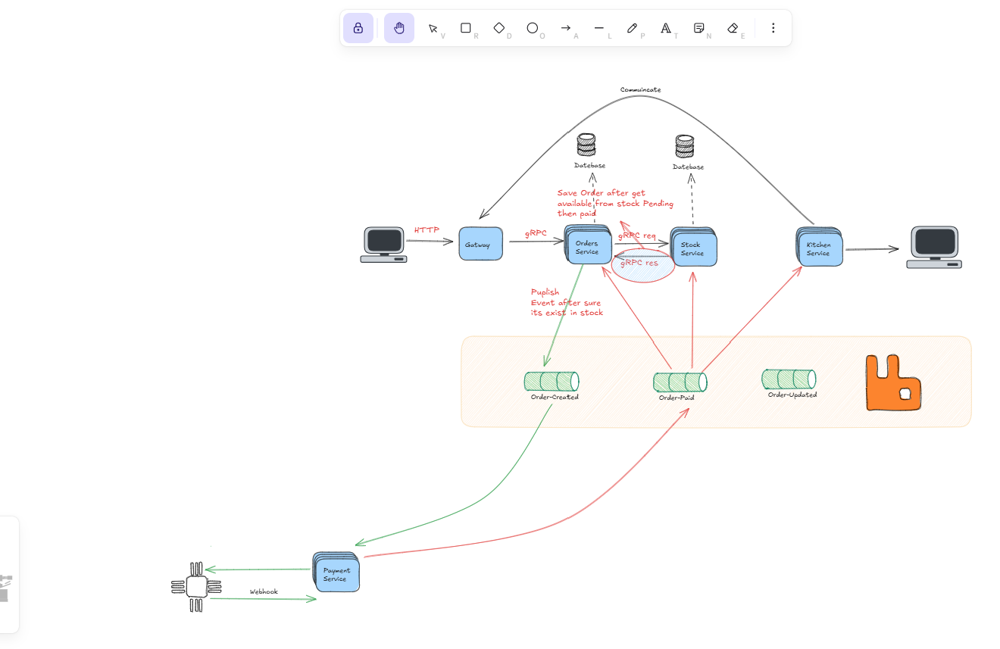

# Microservice Order Management

## System Design



## Sample stock products

Start PostgreSQL from the repository root:

```powershell
docker compose up -d postgres
```

On a new database, apply the Stock schema migrations once, in order:

```powershell
Get-Content -Raw .\stock\migrations\001_create_products.sql | docker compose exec -T postgres psql -v ON_ERROR_STOP=1 -U ammar -d stock_db
Get-Content -Raw .\stock\migrations\002_add_product_price.sql | docker compose exec -T postgres psql -v ON_ERROR_STOP=1 -U ammar -d stock_db
Get-Content -Raw .\stock\migrations\003_add_product_name.sql | docker compose exec -T postgres psql -v ON_ERROR_STOP=1 -U ammar -d stock_db
```

Then seed the sample products from the repository root:

```powershell
Get-Content -Raw .\seed_stock.sql | docker compose exec -T postgres psql -v ON_ERROR_STOP=1 -U ammar -d stock_db
```

The script inserts the following products. Prices are stored as minor units
(for example, `2499` means USD 24.99). Re-running it does not overwrite
existing products.

| ID | Name | Stock quantity | Unit price |
|---|---|---:|---:|
| SKU-001 | Wireless Mouse | 25 | USD 24.99 |
| SKU-002 | Mechanical Keyboard | 15 | USD 79.99 |
| SKU-003 | USB-C Cable | 50 | USD 9.99 |
| SKU-004 | Laptop Stand | 18 | USD 34.99 |
| SKU-005 | 1080p Webcam | 12 | USD 49.99 |
| SKU-006 | USB Hub | 20 | USD 27.99 |
| SKU-007 | Wireless Headphones | 16 | USD 59.99 |
| SKU-008 | Desk Lamp | 22 | USD 31.99 |
| SKU-009 | 24-inch Monitor | 8 | USD 129.99 |
| SKU-010 | Mouse Pad | 30 | USD 14.99 |
| SKU-011 | Ethernet Adapter | 14 | USD 21.99 |
| SKU-012 | Portable SSD 1TB | 9 | USD 109.99 |
| SKU-013 | Bluetooth Speaker | 13 | USD 45.99 |
| SKU-014 | USB-C Charger | 40 | USD 18.99 |
| SKU-015 | Laptop Sleeve | 17 | USD 26.99 |
| SKU-016 | HDMI Cable | 35 | USD 12.99 |
| SKU-017 | USB Microphone | 10 | USD 69.99 |
| SKU-018 | Smart Plug | 24 | USD 17.99 |
| SKU-019 | Power Bank | 11 | USD 39.99 |
| SKU-020 | Monitor Arm | 7 | USD 89.99 |
